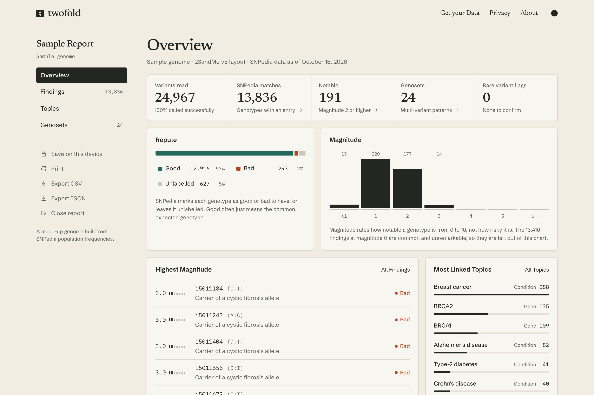

<h1 align="center">
  <br>
  <a href="https://twofold.brandonsaldan.com">
    
    
  </a>
  <br>
  Twofold
  <br>
</h1>

<h4 align="center">Read the rest of your DNA test. A free, open source explorer for raw DNA data that runs entirely in your browser.</h4>

<p align="center">
  <a href="https://astro.build/"></a>
  <a href="https://react.dev/"></a>
  <a href="https://www.typescriptlang.org/"></a>
  <a href="https://www.snpedia.com/"></a>
</p>

<p align="center">
  <a href="#key-features">Key Features</a> •
  <a href="#how-to-use">How To Use</a> •
  <a href="#raw-data">Raw Data?</a> •
  <a href="#run-locally">Run Locally</a> •
  <a href="#the-snpedia-dataset">Dataset</a> •
  <a href="#credits">Credits</a> •
  <a href="#license">License</a>
</p>



## Key Features

* **Informative**
  - See your susceptibility to health conditions, how you might respond to medicines, and traits from metabolism to personality.
  - Every match comes from [SNPedia](https://www.snpedia.com/), ranked by magnitude and labelled good, bad or unlabelled, with the full entry, population frequencies and references a click away.
  - Browse findings by gene, condition, medicine or chromosome, and see genosets, the patterns SNPedia defines across several variants at once.
  - Rare variants that consumer chips often get wrong are flagged so you know what to confirm clinically.
* **Private**
  - Your file is read on your device in a Web Worker and is never uploaded. There is no account, analytics or server route.
  - Every visitor loads the same fixed reference files, so nothing requested from the server depends on your genotypes.
  - After the first visit the site works offline. The privacy page explains how to check this yourself.
  - Reports stay in memory by default. You can choose to save an encrypted copy in your browser, protected by a passphrase. Your raw file is never saved.
* **Easy to Use**
  - Drop in the file from your DNA test. Twofold reads 23andMe, AncestryDNA, MyHeritage, FamilyTreeDNA and Living DNA files, plus VCF files from whole genome sequencing, as text, CSV, ZIP or GZ.
  - Print the report, save it as a PDF, or export your findings as CSV or JSON.
* **Free**
  - Twofold is and will always be free to use.

## How To Use

Visit [Twofold](https://twofold.brandonsaldan.com) and open your raw data file, or try the sample report first. The sample is a made-up genome built from SNPedia population frequencies, not a real person's data.

## Raw Data?

When you take a test from a company like 23andMe or AncestryDNA, your DNA is read at hundreds of thousands of positions. The reports those companies show you cover only a small portion of what was read, but you can download the full results as a raw data file.

That file is a long list of single-nucleotide polymorphisms (SNPs): positions in the genome where people commonly differ by a single letter, along with the two letters you carry at each one. Many of these SNPs have been studied and linked to health conditions, responses to medicines, physical traits and more. SNPedia collects that research, and Twofold matches it against your file.

The site has a step by step guide for downloading your file from [each provider](https://twofold.brandonsaldan.com/get-data/).

## Run Locally

Use Node.js 24 or later.

```sh
npm install
npm run dev
```

`npm run build` writes the static site to `dist`. `npm test` runs the parser and engine tests plus source checks. `npm run test:e2e` builds the site and checks the sample report, a realistic 23andMe file, offline reload, detail reading and encrypted storage in a browser.

## The SNPedia Dataset

The compiled dataset is committed under `public/data`, so the site builds without downloading anything. To refresh it from SNPedia:

```sh
npm run data:fetch
npm run data:build
npm run build
```

The fetch enumerates SNP, genotype, genoset, gene, condition, medicine and all 19 on-chip categories, then downloads page revisions in batches of 50. It makes one request at a time with a pause between them and retries failed responses. Raw responses are cached under `data/raw`, which is ignored by Git, so an interrupted run can resume. `npm run data:fetch -- --refresh` downloads only batches whose revisions changed, and `npm run data:fetch -- --refresh-categories` also re-enumerates category membership.

The builder writes `public/data/core.json` and `public/data/text.json`, and records counts, parsing failures and compressed sizes in `data/build-report.json`.

The current snapshot was downloaded from the SNPedia API on October 16, 2026. It requested 220,056 titles in 4,402 batches and contains 111,734 SNP records, 104,732 genotype annotations and 283 genosets. Compressed, the core data is 3.6 MB and the longer text is 4.7 MB.

## Limitations

- SNPedia is a community-edited reference, not a medical diagnosis. Magnitude and repute describe how notable a genotype is, not certainty or individual risk.
- Consumer DNA chips can report rare variants that are not really there. Confirm anything important with a clinical test and talk to a doctor or genetic counselor before acting on it.
- Twofold makes no guarantee that a report, or any entry in it, is accurate or complete.

## Credits

Twofold was first released as GeneCodex in 2023. Huge thanks to:

- [SNPedia](https://www.snpedia.com/) and its contributors, for the research every report is built on

## Support

If you'd like to support Twofold, all I ask is that you star this repo and follow me on [Twitter](https://twitter.com/brandonsaldan).

## License

The source code is licensed under [CC BY-NC-SA 4.0](LICENSE). SNPedia content and the datasets derived from it are licensed under [CC BY-NC-SA 3.0 US](https://creativecommons.org/licenses/by-nc-sa/3.0/us/). See [data/LICENSE.md](data/LICENSE.md).

---

> [brandonsaldan.com](https://brandonsaldan.com/) &nbsp;&middot;&nbsp;
> GitHub [@brandonsaldan](https://github.com/brandonsaldan) &nbsp;&middot;&nbsp;
> Twitter [@brandonsaldan](https://twitter.com/brandonsaldan)
